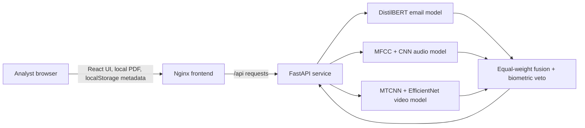

# SynthGuard

**A locally deployed multimodal threat-analysis prototype for email, audio, and video evidence.**

SynthGuard brings three modality-specific detectors into one analyst workflow. It accepts email text, audio recordings, and video clips through a React interface and a local FastAPI service. It reports each available sensor score and status, then applies a transparent late-fusion rule when multiple signals are provided.

> **Research and operational scope:** SynthGuard is a student research prototype for analyst-assisted triage. The available email and audio re-scores are diagnostic and have unresolved checkpoint/data-lineage limitations. There is no verified held-out result for the active video checkpoint and no authentic paired multimodal evaluation. The project does not claim a validated accuracy advantage, an air-gapped host, or suitability for autonomous financial or security decisions.

## Features

- **Email analysis:** fine-tuned DistilBERT classifier for phishing-related text.
- **Audio forensics:** MFCC feature extraction and a PyTorch CNN for synthetic-speech scoring.
- **Video forensics:** MTCNN face-region detection with an EfficientNet-B0 classifier.
- **Late fusion:** available sensor scores are averaged using equal relative weights; a biometric veto applies when the audio or video score is at least `0.85`.
- **Local analyst UI:** modality workspaces, status indicators, and investigation results.
- **Local report workflow:** lightweight report history uses browser `localStorage`; PDF reports are generated in the browser.
- **Docker Compose deployment:** separate FastAPI and Nginx/React services. The frontend is bound to `127.0.0.1` by default.

The video score transform uses the configured threshold (`0.7920` fallback) to recenter logits. That configured value is not a verified calibration result.

## Architecture



Email text is analyzed in memory. Audio and video uploads are written to temporary files for inference and removed after processing. The system is locally deployed; local Docker operation does not by itself establish physical network isolation.

## Quick start with Docker

### Requirements

- Docker Engine and the Docker Compose plugin.
- Enough RAM for PyTorch and the three model checkpoints. Model loading may take a few minutes.
- The model files under `models/final/` included in this project package.

### Run

From the project root:

```bash
cp .env.example .env
docker compose up --build -d
docker compose ps
```

Open <http://127.0.0.1:8080>. Check model availability at <http://127.0.0.1:8080/api/health>.

If port `8080` is already occupied, edit `.env` and set `SYNTHGUARD_PORT=8081`, then run `docker compose up -d`; the UI will be at <http://127.0.0.1:8081>.

The first image build downloads operating-system and Python/Node dependencies. The backend is configured to load the bundled model files locally and run in Hugging Face offline mode after setup. To stop the deployment:

```bash
docker compose down
```

See [`docs/docker_deployment.md`](docs/docker_deployment.md) for deployment details and troubleshooting.

## API endpoints

| Method | Endpoint | Input |
| --- | --- | --- |
| `GET` | `/api/health` | No body; reports model availability. |
| `POST` | `/api/analyze/email` | JSON: `{"text": "..."}` |
| `POST` | `/api/analyze/audio` | Multipart upload field: `file` |
| `POST` | `/api/analyze/video` | Multipart upload field: `file` |
| `POST` | `/api/analyze/multimodal` | Multipart fields: `email_text`, `audio_file`, and/or `video_file`. |

Default input limits are 100,000 email characters, 25 MB / 180 seconds for audio, and 100 MB / 120 seconds for video. Missing modalities are skipped by the fusion endpoint.

## Model files

The deployment expects these local checkpoints:

- `models/final/phishing_email/` — DistilBERT weights and tokenizer files.
- `models/final/audio_detector/audio_cnn_model.pth` — audio CNN weights.
- `models/final/video_detector/model.safetensors_2` — active video checkpoint loaded by the current backend.

Older video checkpoint variants and backup files are not required. Model weights are tracked with Git LFS for GitHub; install Git LFS before cloning if you need to download the model binaries.

## Evaluation status

The repository contains per-sample exports and summaries under `outputs/reports/`. Interpret them with the accompanying limitations:

- The active email checkpoint re-score is **94.95% accuracy on 3,508 saved rows**, but checkpoint exposure to training or model selection has not been ruled out.
- The reconstructed audio sample reports **98.8% accuracy on 500 rows**, including only 51 genuine samples; it lacks source-group provenance and active-checkpoint lineage.
- There is no held-out test result for the active video checkpoint and no genuinely paired multimodal test result.
- Historical ablation percentages are unverified and are not claimed as measured fusion performance.

See [`outputs/reports/README.md`](outputs/reports/README.md) and [`docs/ablation_manifest.md`](docs/ablation_manifest.md). The sample media in the package are for inspection only; they are not a valid train/validation/test split.

## Repository layout

```text
backend/                 FastAPI service and runtime requirements
config/config.py         Empty placeholder; not imported by the current app
frontend-react/          React/TypeScript interface and Docker build files
models/final/            Local model checkpoints and tokenizer assets
notebooks/               Model development and exploration notebooks
scripts/                 Evaluation, data preparation, and training utilities
src/                     Model, fusion, and training helpers
docs/                    Deployment, evaluation, and project documents
outputs/reports/         Diagnostic prediction exports and evidence notes
DATASET_SAMPLES/         Compact sample datasets (inside the distribution ZIP only)
```

The full training datasets and generated pickle shards are intentionally not included in this repository distribution. The ZIP package contains a small, documented sample subset; see `DATASET_SAMPLES/SAMPLE_MANIFEST.txt` when using that package.

## Dependencies

The Docker deployment installs the runtime dependencies from `backend/requirements.txt`, the extra Python packages pinned in `backend/Dockerfile`, and JavaScript packages locked by `frontend-react/package-lock.json`. [`DEPENDENCIES.txt`](DEPENDENCIES.txt) lists the libraries, versions, and system packages. `requirements.txt` at the root contains the broader notebook/development environment.

## Privacy, data, and limitations

- Do not upload private emails, recordings, or videos to a public repository.
- Do not commit `.env` files, credentials, local datasets, generated training shards, or the distribution ZIP.
- The full ASVspoof and FaceForensics++ datasets are not included. Follow their original access and license terms when obtaining them.
- Browser report history is stored in that browser's local storage; it is not a server-side case database.
- A successful `/api/health` response confirms that models loaded, not their detection accuracy or security certification.

## License

No project-wide open-source license is currently specified. Dataset terms remain separate. Do not assume that the project or the bundled sample media can be redistributed beyond their applicable terms.
